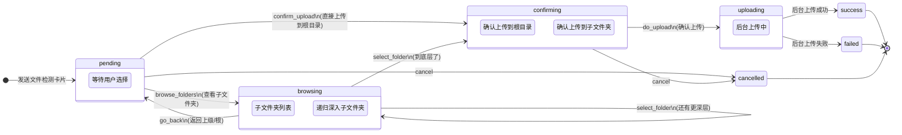
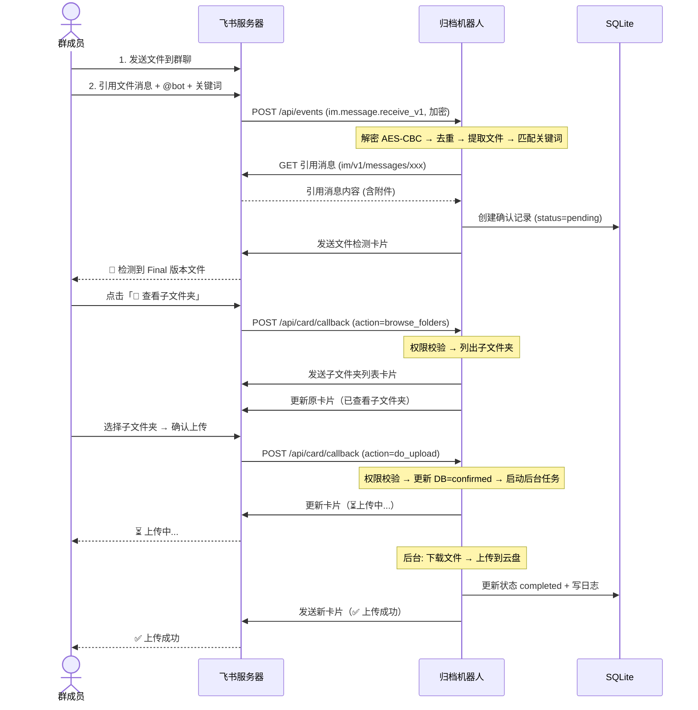

# 飞书附件归档机器人 — 流程设计文档

> 版本：v2.0 | 日期：2026-07-01 | 代码仓库：[feishu-archive-bot](https://github.com/Calvincheng-ops/feishu-archive-bot)
>
> 基于实际代码实现（Python 3.11 + FastAPI + lark-oapi SDK + SQLite）整理。

---

## 一、概述

机器人在飞书群聊中运行。群成员**先发文件到群**，然后**引用该文件消息**、@机器人并说出触发关键词（如「这是 final 版本」），机器人自动发起归档流程。

核心设计理念：
- 一条消息触发多个卡片交互步骤，通过「新卡片 + 更新原卡片」机制实现清晰的多步操作链路
- 仅发送人可操作，防止误操作
- 消息去重 + SQLite 状态记录，保证幂等

---

## 二、前置配置

### 2.1 群 → 根目录映射

每个群聊对应一个飞书共享云文件夹根目录。映射关系支持两种方式：

| 方式 | 场景 | 代码位置 |
|------|------|---------|
| 硬编码 | 测试 / 少量群 | `main.py` 的 `lifespan()` 中调用 `add_hardcoded_mapping()` |
| 多维表格 | 生产 / 多群 | `.env` 配 `BITABLE_APP_TOKEN` + `BITABLE_TABLE_ID`，从飞书多维表格动态读取 |

### 2.2 触发关键词（正则匹配）

```
final 版本 / final版 / final
最终版本 / 最终版
定稿
正式版本 / 正式版
确认归档
请上传到云盘
归档文件 / 归档此文件
上传到云盘/网盘/云空间
保存到云盘/网盘/云空间
```

> `keyword_matcher.py` 使用 `re.IGNORECASE` 去做大小写不敏感匹配，返回 `MatchResult(matched, keyword, confidence)`。

### 2.3 机器人权限要求

| 权限 | 说明 |
|------|------|
| `im:message` | 接收消息 |
| `im:message:send_as_bot` | 发送消息/卡片 |
| `im:resource` | 下载资源文件 |
| `im:chat:readonly` | 读取群信息 |
| `drive:drive` | 云盘文件操作 |
| `drive:file` | 文件上传 |
| `contact:user.base:readonly` | 获取用户信息（卡片显示发送人姓名） |

---

## 三、核心流程

### 3.0 实际操作方式（关键！）

与直觉不同，正确的操作流程是：

```
1. 群成员先发文件到群聊（一条普通文件消息）
2. 群成员引用（quote）这条文件消息
3. 在引用中 @机器人，并说「这是 final 版本」
4. 机器人从被引用的消息中提取附件
```

飞书不支持在一条消息中同时发送文件和文本，所以「先发再引用」是唯一可行的方式。机器人通过 `parent_id` / `root_id` 追溯被引用消息的附件。

---

### 3.1 触发阶段

```
群成员引用文件消息 → @机器人 + 触发关键词
```

机器人 `event_handler.py` 处理流程：

1. 收到 `im.message.receive_v1` 事件 → 解密（AES-CBC）
2. 消息去重：`message_id` 已在 `_processed_messages` set 中？→ 跳过
3. 校验：`chat_type == "group"` 且有 `mentions` 包含 bot
4. 提取文件：先从当前消息取，没有则查 `parent_id` / `root_id` 指向的被引用消息
5. 仍无附件 → 发送「未检测到附件」提示卡片
6. 关键词匹配 → 未命中则静默返回
7. 查群 → 文件夹映射 → 未配置则发送「未配置归档目标」卡片
8. 获取发送人姓名（`contact.v3.user.get`）
9. 检查根目录下有无子文件夹（`drive/v1/files?folder_token=xxx`）
10. 创建 SQLite 确认记录（`confirmations` 表，状态 `pending`）
11. **发送初始卡片**（`build_file_detected_card`）

---

### 3.2 初始卡片（文件检测卡片）

```
┌──────────────────────────────────────────┐
│  📁 检测到 Final 版本文件                 │  ← header blue
│                                           │
│  文件名：设计稿_最终版.psd                 │
│  目标文件夹：共享空间 > 设计组 > 终稿      │
│  发送人：张三                             │
│  ─────────────────────────────────────    │
│  ⚠️ 仅发送人可操作                        │
│                                           │
│  [📂 查看子文件夹]  [⬆️ 直接上传到根目录]  │
│  [❌ 取消]                                │
└──────────────────────────────────────────┘
```

三个按钮，`value` 中携带完整上下文：

| 按钮 | action | 携带数据 |
|------|--------|---------|
| 📂 查看子文件夹 | `browse_folders` | file_key, folder_token, message_id, file_name, sender_name |
| ⬆️ 直接上传到根目录 | `confirm_upload` | 同上 + folder_name |
| ❌ 取消 | `cancel` | message_id |

> 注意：「查看子文件夹」按钮仅在根目录下有子文件夹时才显示（`has_subfolders=True`）。如果根目录为空文件夹，只显示后两个按钮。

---

### 3.3 路径 A：子文件夹浏览 + 发送

这是最完整的交互链路。

#### 步骤 A1：点击「📂 查看子文件夹」

- 卡片回调 → `_handle_browse_folders`
- 权限校验：操作人 `open_id` == 发送人 `open_id`？→ 不匹配则返回「无权操作」卡片
- 调用 `list_folder_children(folder_token)`，只返回 `type == "folder"` 的项
- 有两种结果：

**结果 1：有子文件夹** → 发送子文件夹列表卡片（`build_folder_list_card`）：

```
┌──────────────────────────────────────────┐
│  📂 选择子文件夹 — 归档文件夹              │  ← header blue
│                                           │
│  文件：设计稿_最终版.psd                   │
│  请选择要上传到的子文件夹：                 │
│                                           │
│  [📁 2026-Q3]   [📁 2026-Q2]   [📁 海报类] │
│  [📁 Banner]    [📁 品牌素材]             │  ← 最多 10 个
│                                           │
│  [⬅️ 返回]                                │
└──────────────────────────────────────────┘
```

同时**更新原卡片**为已操作状态（`build_browse_done_card`）：

```
┌──────────────────────────────────────────┐
│  📂 已查看子文件夹                        │  ← header grey
│                                           │
│  子文件夹列表已发送，请在下方卡片中选择。    │
│  （无按钮）                                │
└──────────────────────────────────────────┘
```

**结果 2：无子文件夹** → 直接进入确认卡片（跳至步骤 A3）。

#### 步骤 A2：选择子文件夹（支持递归深入）

- 点击文件夹按钮 → `_handle_select_folder`
- 权限校验
- 再次调用 `list_folder_children(selected_folder_token)`
- **如果还有子文件夹**：再发一张新的文件夹列表卡片，标题使用当前文件夹名，用户可继续深入选择（递归）。「返回」按钮的 `go_back` 带 parent folder token，可逐级退出。
- **如果没有子文件夹了**：进入确认卡片

> 这是代码中实现的递归浏览：`select_folder` → 检查子文件夹 → 有则继续展示列表，无则显示确认卡片。用户可以在一棵不限深度的文件夹树中自由导航。

#### 步骤 A3：确认上传卡片

```
┌──────────────────────────────────────────┐
│  📋 确认上传                              │  ← header orange
│                                           │
│  文件名：设计稿_最终版.psd                 │
│  目标路径：归档文件夹 / 2026-Q3            │
│  发送人：张三                             │
│  ─────────────────────────────────────    │
│  ⚠️ 仅发送人可操作确认                    │
│                                           │
│  [✅ 确认上传]   [❌ 取消]                 │
└──────────────────────────────────────────┘
```

#### 步骤 A4：点击「✅ 确认上传」→ 背景上传

- 卡片回调 → `_handle_do_upload`
- 权限校验（最后一次）
- 查 SQLite 确认记录（必须存在且状态为 pending）
- 更新状态为 `confirmed`
- **立即返回**上传中卡片（`build_uploading_card`）更新当前卡片：

```
┌──────────────────────────────────────────┐
│  ⏳ 上传中...                             │  ← header wathet
│                                           │
│  正在上传 设计稿_最终版.psd，请稍候...     │
│  （无按钮）                                │
└──────────────────────────────────────────┘
```

- **同时启动** `asyncio.create_task(self._do_upload_background(...))` 后台执行：
  1. `file_transfer_service.download_and_upload()` → 从飞书服务器下载文件 → 上传到目标文件夹
  2. 成功 → 更新 DB 状态 `completed` + 写操作日志 → **发送新卡片**「上传成功」
  3. 失败 → 更新 DB 状态 `failed` + 写错误日志 → **发送新卡片**「上传失败」

#### 步骤 A5：后台完成后的结果卡片

**成功：**

```
┌──────────────────────────────────────────┐
│  ✅ 上传成功                              │  ← header green
│                                           │
│  文件上传成功                             │
│  文件名：设计稿_最终版.psd                 │
│  目标文件夹：归档文件夹                    │
│  [点击查看文件]  （如果有 file_url）       │
│  （无按钮）                                │
└──────────────────────────────────────────┘
```

**失败：**

```
┌──────────────────────────────────────────┐
│  ❌ 上传失败                              │  ← header red
│                                           │
│  文件名：设计稿_最终版.psd                 │
│  失败原因：文件大小 150.0MB 超过限制 100MB │
│  请联系管理员或手动上传。                  │
│  （无按钮）                                │
└──────────────────────────────────────────┘
```

---

### 3.4 路径 B：直接上传到根目录

- 点击「⬆️ 直接上传到根目录」→ `_handle_confirm_upload`
- 不发子文件夹列表，直接做两件事：
  1. **发送新卡片**：确认上传卡片（目标文件夹 = 根目录名），让用户确认
  2. **返回 update**：更新原卡片为「已选择文件夹」状态（`build_selected_card`），按钮消失
- 后续确认 → 上传 → 结果流程与 3.3 完全相同。

---

### 3.5 路径 C：取消

- 点击「❌ 取消」→ `_handle_cancel`
- 权限校验（仅发送人可取消）
- 额外检查：如果确认记录状态已是 `completed` 或 `confirmed`，拒绝取消（返回「文件已上传成功，无法取消」）
- 否则返回取消卡片（`build_cancel_card`），无按钮。

---

### 3.6 卡片更新机制总结

本项目使用「**新卡片 + 更新原卡片**」双卡片策略，而非在单张卡片上逐步替换元素：

| 步骤 | 新发送的卡片 | 原卡片更新为 |
|------|------------|------------|
| 初始 | 文件检测卡片 | — |
| 点击查看子文件夹 | 子文件夹列表卡片 | 已查看子文件夹（无按钮） |
| 选择子文件夹（有更深层） | 新的子文件夹列表卡片 | — |
| 选择子文件夹（到底了） | 确认上传卡片 | — |
| 点击直接上传根目录 | 确认上传卡片 | 已选择文件夹（无按钮） |
| 点击确认上传 | — | 上传中...（无按钮） |
| 上传后台完成 | 成功/失败卡片 | — |
| 点击取消 | — | 已取消（无按钮） |

这个设计的好处是群聊中可以回溯完整的操作链路，每一步都留下独立的卡片记录。

---

## 四、卡片状态机



---

## 五、流程图（全链路 Mermaid）

```mermaid
flowchart TD
    A["🔔 群成员引用文件消息\n+ @机器人 + 关键词"] --> B{"校验通过？"}
    B -->|msg_id 重复| C["静默跳过"]
    B -->|非群聊/未@bot| C
    B -->|无附件| D["发送「未检测到附件」卡片"]
    B -->|无关键词| C
    B -->|✅ 全部通过| E["查群→根目录映射"]

    E --> F{"映射存在？"}
    F -->|否| G["发送「未配置归档目标」卡片"]
    F -->|是| H["获取发送人姓名\n检查根目录子文件夹\n创建 SQLite 确认记录"]

    H --> I["发送「文件检测」卡片\n(📂子文件夹 / ⬆️根目录 / ❌取消)"]

    I --> J{"用户点击哪个按钮？"}

    J -->|📂 查看子文件夹| K["权限校验"]
    K --> L{"有子文件夹？"}
    L -->|有| M["新卡片：子文件夹列表\n原卡片更新：已查看子文件夹"]
    L -->|无| N["新卡片：确认上传\n(目标=根目录)"]

    M --> O{"用户操作？"}
    O -->|选择子文件夹| P["权限校验 → 列出下级"]
    P --> Q{"还有子文件夹？"}
    Q -->|有| M
    Q -->|无| N
    O -->|⬅️ 返回| I

    J -->|⬆️ 直接上传根目录| R["权限校验\n新卡片：确认上传\n原卡片更新：已选择文件夹"]
    R --> N

    J -->|❌ 取消| S["权限校验\n检查是否已上传\n原卡片更新：已取消"]

    N --> T{"用户操作？"}
    T -->|✅ 确认上传| U["权限校验\n更新 DB 状态=confirmed\n原卡片更新：⏳上传中..."]
    T -->|❌ 取消| S

    U --> V["后台异步任务：\n下载文件 → 上传到目标文件夹"]

    V --> W{"上传结果？"}
    W -->|成功| X["新卡片：✅ 上传成功\nDB 状态=completed\n写操作日志"]
    W -->|失败| Y["新卡片：❌ 上传失败\nDB 状态=failed\n写错误日志"]

    style A fill:#e1f5fe
    style X fill:#c8e6c9
    style Y fill:#ffcdd2
    style S fill:#eeeeee
    style D fill:#fff3e0
    style G fill:#fff3e0
```

---

## 六、数据流



---

## 七、状态管理（SQLite）

### confirmations 表

| 字段 | 类型 | 说明 |
|------|------|------|
| message_id | TEXT | 触发消息 ID（去重 key） |
| file_key | TEXT | 附件 key |
| file_name | TEXT | 文件名 |
| folder_token | TEXT | 目标文件夹 token |
| sender_id | TEXT | 发送人 open_id（权限校验 key） |
| chat_id | TEXT | 群 ID |
| source_message_id | TEXT | 文件所在消息 ID（可能≠触发消息 ID） |
| card_message_id | TEXT | 卡片消息 ID |
| status | TEXT | pending → confirmed → completed / failed |
| created_at | TIMESTAMP | 创建时间 |
| confirmed_at | TIMESTAMP | 确认时间 |
| completed_at | TIMESTAMP | 完成时间 |

### operation_logs 表

| 字段 | 类型 | 说明 |
|------|------|------|
| chat_id | TEXT | 群 ID |
| sender_id | TEXT | 操作人 |
| file_name | TEXT | 文件名 |
| folder_token | TEXT | 目标文件夹 |
| status | TEXT | success / failed |
| error_msg | TEXT | 错误详情 |
| details | TEXT | 扩展信息 |
| timestamp | TIMESTAMP | 操作时间 |

---

## 八、异常处理

| 异常场景 | 代码中的处理方式 |
|---------|----------------|
| 飞书事件重复推送 | `_processed_messages` set 去重（生产建议换 Redis） |
| 群未配置根目录 | 发送 `build_no_mapping_card` 提示管理员配置 |
| 消息无附件 | 发送 `build_no_attachment_card` 指导正确用法 |
| 根目录/子文件夹已被删除 | `list_folder_children` 返回空列表 → 直接用根目录 |
| 文件超限 (>100MB) | `FileTooLargeError` → 返回失败卡片含具体大小 |
| 附件下载失败 | `file_transfer` catch → 返回 `transfer_error` 卡片 |
| 上传 API 调用失败 | `lark_client.upload_file` 抛异常 → 卡片显示错误信息 |
| 非发送人点击按钮 | `_check_sender_permission` 返回 False → 返回「无权操作」卡片 |
| 重复点击确认上传 | `confirmations.status` 非 `pending` 时拒绝 |
| 已上传后点取消 | 检查 status ∈ {completed, confirmed} → 返回「文件已上传」错误卡片 |
| 获取用户信息失败 | catch 异常 → 显示「未知用户」，不阻断流程 |
| 卡片过期 | 飞书客户端自动禁用按钮（无额外处理） |

---

## 九、关键工程经验（来自 README 踩坑记录）

以下是从实际开发和部署中总结的经验，与代码实现强相关：

1. **飞书事件默认加密**：所有事件推送的 body 是 `{"encrypt": "..."}` 格式，必须用 AES-CBC 解密。依赖 `pycryptodome`，解密逻辑见 `main.py` 的 `decrypt_event()`。

2. **系统环境变量覆盖**：macOS 上如果用 Hermes Agent，系统中存在 `FEISHU_APP_ID` / `FEISHU_APP_SECRET` 环境变量会覆盖 `.env`。所以在 `config.py` 中使用自定义变量名 `BOT_APP_ID` / `BOT_APP_SECRET`。

3. **飞书不支持同时发文件和文字**：所以触发方式必须是「先发文件 → 引用 → @机器人」。代码通过 `parent_id` / `root_id` 追溯被引用消息的附件。

4. **卡片回调必须返回卡片 JSON**：`/api/card/callback` 返回更新的卡片 JSON 才能刷新原卡片 UI。返回 `{"code": 0}` 不会更新。

5. **卡片回调 URL 验证**：配置回调地址时飞书会发 challenge 请求，必须在 handler 中处理 `"challenge" in body` 并原样返回。

6. **机器人用 tenant_access_token**：上传的文件属于应用本身，不是用户。应用需要自己创建文件夹，或使用共享空间中的文件夹。

7. **用户信息需权限 + 可见范围**：`contact.v3.user.get` 需要 `contact:user.base:readonly` 权限，且该用户在应用的可用范围内。

8. **systemd 要指定 venv Python**：生产部署用 systemd 时，`ExecStart` 必须指向虚拟环境的 Python，否则找不到 uvicorn 等模块。

9. **端口占用**：`lsof -ti:8000 | xargs kill -9` 清理后再重启。

---

## 十、回顾：代码实现 vs 原始需求

| 你的原始需求 | 代码实际实现 | 差异说明 |
|------------|------------|---------|
| @机器人 + 发附件 + 关键词 | 先发文件 → 引用 → @机器人 + 关键词 | 受限于飞书不支持同时发文件+文字 |
| 跳出一个卡片，三个按钮 | 初始卡片 + 后续步骤发新卡片 + 更新原卡片 | 实际用多卡片策略，群聊可回溯完整链路 |
| 点击根目录 → 确认 → 发送 → 成功 | 确认上传 → 后台异步上传 → 完成卡片 | 确认后立即返回上传中状态，上传走后台 |
| 选择子文件夹 → 往下跳 | 递归深入子文件夹 + 返回上级 | 支持无限层级树形导航 |
| 已操作状态，按钮不再显示 | 每步更新原卡片为灰色 + 无按钮 / 最终卡片无按钮 | 状态通过不同卡片模板实现 |
| 仅发送人可操作 | 每一步回调都校验 `open_id` | 严格权限控制 |

---

## 十一、目录结构

```
feishu-archive-bot/
├── app/
│   ├── main.py                  # FastAPI 入口，事件/卡片回调路由 + 解密
│   ├── config.py                # Pydantic Settings (.env 管理)
│   ├── event_handler.py         # 核心业务：消息处理 + 6 种卡片回调分发
│   ├── models/__init__.py
│   ├── services/
│   │   ├── card_builder.py      # 飞书交互卡片 JSON 构建（9 种卡片模板）
│   │   ├── keyword_matcher.py   # 关键词正则匹配 + MatchResult
│   │   ├── file_transfer.py     # 文件下载/上传 + FileInfo + FileTooLargeError
│   │   ├── mapping_service.py   # 群→文件夹映射 + 硬编码/多维表格双模式
│   │   └── state_manager.py     # SQLite 状态管理（confirmations + operation_logs）
│   └── utils/
│       └── lark_client.py       # lark-oapi SDK 封装（7 个 API 操作）
├── data/archive_bot.db          # SQLite 运行时数据库
├── .env.example
├── .gitignore
├── requirements.txt             # fastapi, uvicorn, lark-oapi, aiosqlite, pycryptodome, pydantic-settings
├── Dockerfile
├── docker-compose.yml
├── feishu-archive-bot.service   # systemd 生产部署
├── 飞书附件归档机器人-流程设计.md   # 本文档
└── README.md
```

---

## 十二、总结

代码实现覆盖了原始需求的核心流程：触发识别 → 卡片交互 → 文件夹选择 → 确认上传 → 后台归档 → 结果通知。同时在以下方面做了增强：

- 消息去重防止飞书重推事件导致重复卡片
- 严格发送人权限校验（每一步）
- SQLite 持久化状态 + 操作日志
- 引用消息附件追溯（适配飞书消息格式限制）
- 递归子文件夹浏览（不限深度）
- 后台上传不阻塞卡片回调返回
- 代码量约 900 行 Python，结构清晰，已通过 Docker 和 systemd 验证部署。

与原始流程图的主要差异在于：实际操作是先发文件再引用、卡片采用「新卡片 + 更新原卡片」双卡策略、上传走后台异步。这些差异主要来源于飞书平台本身的限制和实际工程优化。
